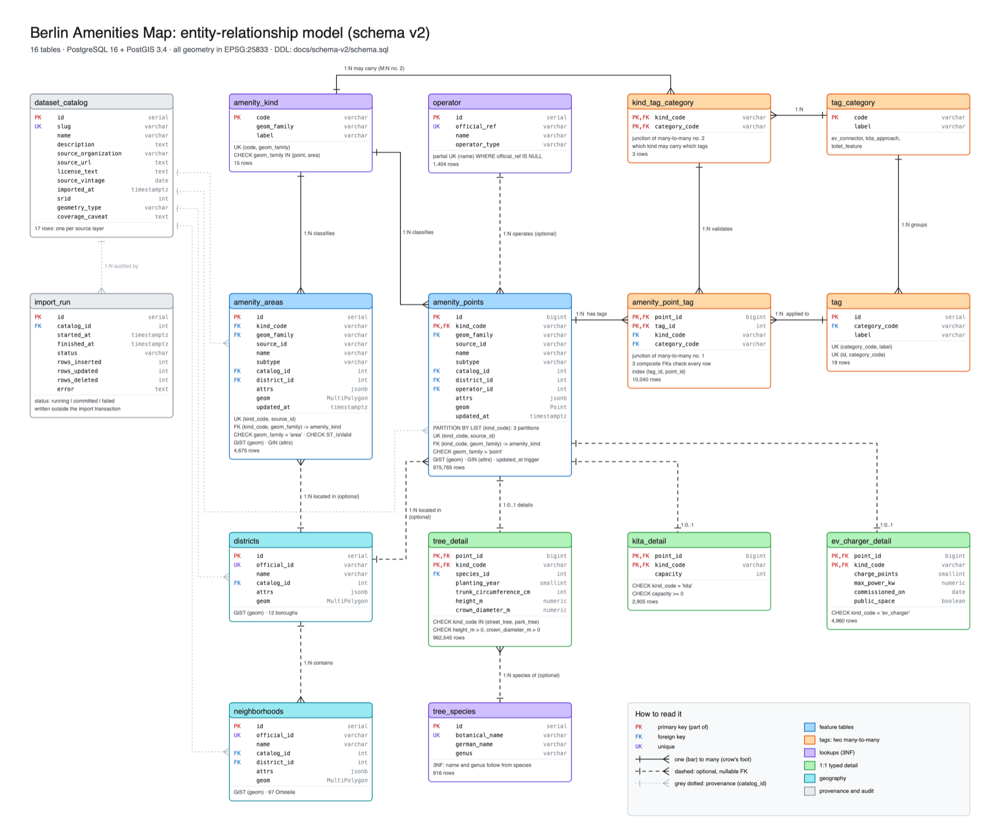

# Berlin Amenities Map

An interactive map of Berlin's public amenities on PostgreSQL + PostGIS. It holds **980,440 real features** from official Berlin open data (street and park trees, parks, playgrounds, daycare centres, EV chargers, toilets and more) and answers spatial questions about them in milliseconds.

**Context:** hand-in for the Databases module. Solo project: schema, importer, data layer, API, frontend, operations and documentation are all my own work.

**Stack:** Docker · PostgreSQL 16 + PostGIS 3.4 · FastAPI · SQLAlchemy 2 / GeoAlchemy2 · Alembic · React + MapLibre

## Use cases

All implemented and served by the data layer in [backend/](backend/) (ORM models plus the SQL files in [backend/sql/](backend/sql/)).

| # | Use case | Endpoint |
| --- | --- | --- |
| U1 | Show amenity layers on the map, filtered to the visible area | `GET /<layer>` |
| U2 | Click the map: nearest amenity of each kind, with distance | `GET /analyses/nearest-amenities` |
| U3 | Amenity counts per borough, with a city total | `GET /analyses/amenity-density-by-borough` |
| U4 | Park area share per borough | `GET /analyses/green-by-borough` |
| U5 | Distance from schools to the nearest park (median, p90) | `GET /analyses/school-green-proximity` |
| U6 | Read-only SQL playground with `EXPLAIN` | `POST /sql/run` |
| U7 | Filter by tag (charger connector, Kita approach, toilet feature), also in a radius | `?tag=`, `GET /amenities/near` |
| U8 | Largest operators per borough; tree statistics per borough | `GET /analyses/operators`, `/analyses/trees-by-borough` |
| U9 | Source, licence and caveats per layer; one feature with its tags and details | `GET /layers`, `GET /features/{layer}/{id}` |

**Not implemented:** editing data in the app (imports are offline scripts), user accounts, routing (distances are straight-line).

## Setup

You need Docker, Python 3 and Node.js. No API keys.

```bash
cp .env.example .env                 # DATABASE_URL and DATABASE_URL_RO (read-only role)
docker compose up -d                 # PostGIS on localhost:5432

cd backend
python3 -m venv .venv && source .venv/bin/activate
pip install -r requirements.txt
alembic upgrade head                 # creates the schema (migrations 0001–0013)
python -m scripts.import_v2          # full import, ~40 min (add --source samples for a seconds-long test load)
uvicorn app.main:app --reload --port 8000

cd frontend && npm install && npm run dev   # in a second terminal
```

App: http://localhost:5173 · API docs: http://localhost:8000/docs. The app connects with `DATABASE_URL`; the SQL playground uses `DATABASE_URL_RO` (role `berlin_ro`). If port 5432 is taken, set `POSTGRES_PORT=5433` and use 5433 in both URLs.

## Data

Real open data from Geoportal Berlin and daten.berlin.de, **nothing generated** ([sources and licences](docs/data-sources.md)). After a full import the database is 1.4 GB:

- **980,440 features:** 527,780 park trees, 434,765 street trees, 4,960 EV chargers, 2,905 Kitas, 2,563 parks, 2,374 bike parking, 1,886 playgrounds, 1,085 sports facilities, 930 schools, 525 toilets, 242 fountains, 226 cemeteries, 111 hospitals, 49 park-and-ride, 39 bathing waters
- **Supporting rows:** 12 boroughs, 97 neighbourhoods, 1,404 operators, 916 tree species, 19 tags with 10,040 tag links

Re-running the import changes nothing (0 inserted, 0 updated, 0 deleted).

## ER model



16 tables. The design in five points:

- **Two feature tables instead of fifteen:** `amenity_points` and `amenity_areas`, classified by `amenity_kind`.
- **Two many-to-many relationships:** points ⟷ tags through `amenity_point_tag`, and kinds ⟷ tag categories through `kind_tag_category`. Composite foreign keys stop a Kita tag landing on a toilet.
- **Normalised to 3NF:** operators and tree species are lookups; trees, Kitas and chargers have 1:1 detail tables.
- **Partitioned:** `amenity_points` is list-partitioned by kind (street trees, park trees, other).
- **The database enforces the rules:** CHECK, UNIQUE and FK constraints, tested in [test_constraints.py](backend/tests/test_constraints.py).

Editable version: [docs/erd.excalidraw](docs/erd.excalidraw). Details: [ERD with index list](docs/schema-v2/erd.md) · [design decisions](docs/schema-v2/design-decisions.md) · [normalisation](docs/schema-v2/normalization.md).

## Performance, measured

| Question | Result |
| --- | --- |
| Nearest neighbour: KNN `<->` vs sorting by distance | **0.7 ms** vs 2,029 ms |
| Street trees in a map window: partitioned vs flat table | **16.6 ms** vs 79.2 ms |
| Genus lookup on 435k trees: GIN index vs sequential scan | **5.5 ms** vs 389.6 ms |
| Tree statistics per borough: materialized view vs live query | **0.1 ms** vs ~11 s |

Plans: [indexing and EXPLAIN](docs/schema-v2/indexing-and-explain.md).

## Tests and operations

`cd backend && pytest -q` runs 85 tests (constraints, importer, API, query plans, SQL playground). Each layer import is one transaction ([ACID](docs/schema-v2/acid-and-transactions.md)). WAL archiving, base and logical backups and a rehearsed point-in-time recovery are in [operations](docs/operations.md).
