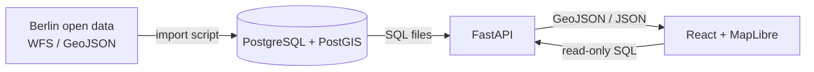

# Berlin Amenities Map

An interactive map of Berlin's public amenities, built on PostGIS. It loads **980,440 real features** from official Berlin open data (every street tree, park, playground, daycare, EV charger, public toilet and more) and answers spatial questions about them in milliseconds.

Click anywhere in the city to find the nearest amenity of each kind, compare boroughs, filter by tags, or write your own SQL against the live database.

**Context:** hand-in for the university Databases module. This is a solo project: the schema, importer, data layer, API, frontend, operations and documentation were all designed and written by the author.

## At a glance

| | |
| --- | --- |
| **Features** | 980,440 across 15 amenity kinds, 12 boroughs and 97 neighbourhoods |
| **Largest layers** | 527,780 park trees · 434,765 street trees · 4,960 EV chargers · 2,905 daycare centres |
| **Data** | 100% official Berlin open data, nothing generated ([sources and licences](docs/data-sources.md)) |
| **Database** | PostgreSQL + PostGIS, 1.4 GB after a full import |
| **Stack** | Docker · FastAPI · SQLAlchemy 2 / GeoAlchemy2 · Alembic · Vite / React / MapLibre |

## Use cases

| # | Use case | Status | Where |
| --- | --- | --- | --- |
| U1 | **Browse the map.** Toggle amenity layers, filtered to the visible map window; the tree layers appear once you zoom in far enough. | implemented | `GET /<layer>` |
| U2 | **Find what is nearby.** Click the map to get the nearest park, playground, toilet, charger, hospital and so on, with straight-line distances in metres. | implemented | `GET /analyses/nearest-amenities` |
| U3 | **Compare boroughs: amenity counts** per borough, with a city total. | implemented | `GET /analyses/amenity-density-by-borough` |
| U4 | **Compare boroughs: park area share** per borough. | implemented | `GET /analyses/green-by-borough` |
| U5 | **School to park distance:** how far schools are from the nearest park (median and 90th percentile). | implemented | `GET /analyses/school-green-proximity` |
| U6 | **Query it yourself.** A read-only SQL playground with a schema glossary, ready-made query patterns and `EXPLAIN`, running as database role `berlin_ro`. | implemented | `POST /sql/run` |
| U7 | **Filter by tags.** EV chargers by connector type, daycare centres by pedagogical approach, toilets by feature, also combined with a radius search. | implemented | `?tag=` on the layer endpoints, `GET /tags`, `GET /amenities/near` |
| U8 | **See who runs what.** The largest operators per borough and daycare capacity; tree statistics per borough. | implemented | `GET /analyses/operators`, `GET /analyses/trees-by-borough` |
| U9 | **Check where the data comes from.** Every layer shows its source, licence, vintage and known caveats; one feature shows its operator, tags and typed detail. | implemented | `GET /layers`, `GET /features/{layer}/{id}` |

**Not implemented:** editing data through the app (imports are offline scripts and the API only reads), user accounts, and routing or walking distances (all distances are straight-line).

## How it works



1. **Import.** An offline script downloads 17 layers and upserts them. Running it again changes nothing: 0 inserted, 0 updated, 0 deleted, and every id stays the same.
2. **Database.** PostGIS does the spatial work: nearest-neighbour search, containment, area and distance calculations. The queries are plain SQL files in [backend/sql/](backend/sql/).
3. **API.** FastAPI serves map layers as GeoJSON and analyses as JSON.
4. **Frontend.** A React app with a MapLibre map and a query tab.

## Quick start

You need Docker, Python 3 and Node.js. No external API keys.

```bash
# 1. Environment
cp .env.example .env

# 2. Database
docker compose up -d

# 3. Backend
cd backend
python3 -m venv .venv
source .venv/bin/activate
pip install -r requirements.txt
alembic upgrade head              # creates the schema
python -m scripts.import_v2       # full import, about 40 minutes including trees
uvicorn app.main:app --reload --host 0.0.0.0 --port 8000

# 4. Frontend (new terminal)
cd frontend
npm install
npm run dev
```

Then open the app at http://localhost:5173 and the API docs at http://localhost:8000/docs.

**Faster first run.** The two tree inventories are about 960,000 rows and take most of the import time.

```bash
# Tiny offline fixtures only (seconds)
python -m scripts.import_v2 --source samples

# Real data without the trees
python -m scripts.import_v2 --layers districts,neighborhoods,green_spaces,schools,bike_parking,ev_chargers,drinking_fountains,bathing_waters,toilets,playgrounds,sports_facilities,kitas,hospitals,cemeteries,park_and_ride
```

<details>
<summary>Setup notes: ports, local Postgres, environment variables</summary>

- **Port 5432 already in use** (for example by Homebrew Postgres): start Docker with `POSTGRES_PORT=5433 docker compose up -d db` and use port 5433 in both URLs in `.env`.
- **Local Postgres instead of Docker:** `createdb berlin && psql -d berlin -c "CREATE EXTENSION postgis;"`, then set `DATABASE_URL=postgresql+psycopg://YOUR_USER@localhost:5432/berlin` in `.env`.
- **Environment:** `.env` holds only `DATABASE_URL` and `DATABASE_URL_RO` and is gitignored. `DATABASE_URL_RO` connects as the read-only role `berlin_ro`, which the SQL playground uses.
- **Migrations:** `alembic upgrade head` applies 0001–0013 in order. Migration 0011 drops the legacy per-layer tables, so on a fresh database they are created and dropped again.

</details>

## Data

All data is real open data from Geoportal Berlin (WFS) and daten.berlin.de; nothing is generated. Counts after a full import (`python -m scripts.import_v2`, 17 layers):

| Kind | Features |
| --- | ---: |
| Park trees | 527,780 |
| Street trees | 434,765 |
| EV chargers | 4,960 |
| Daycare centres (Kitas) | 2,905 |
| Parks and green spaces | 2,563 |
| Bike parking | 2,374 |
| Playgrounds | 1,886 |
| Sports facilities | 1,085 |
| Schools | 930 |
| Public toilets | 525 |
| Drinking fountains | 242 |
| Cemeteries | 226 |
| Hospitals | 111 |
| Park and ride | 49 |
| Bathing waters | 39 |
| **Total** | **980,440** |

Alongside the features, the database holds 1,404 operators, 916 tree species and 19 tags with 10,040 tag assignments. Each feature keeps its raw source properties, so nothing from the original record is lost.

## Database design

The schema is the core of the project. The main ideas:

- **Two feature tables instead of one per layer.** All point amenities live in `amenity_points`, all polygons in `amenity_areas`, each classified by kind.
- **Partitioned by kind.** `amenity_points` is split into street trees, park trees and everything else, so a query for one kind never touches the other 500,000 rows.
- **The database enforces consistency.** It refuses an area kind in the points table, a daycare tag on a toilet, a duplicate source key or a tree with zero height. These rules are tested in [test_constraints.py](backend/tests/test_constraints.py).
- **Normalised where it pays off.** Tags, operators and tree species are lookup tables; trees, daycare centres and EV chargers have typed detail tables.
- **Every import is audited.** Each layer import writes a row with what was inserted, updated and deleted.

### Entity-relationship model

The full ER model is in [docs/schema-v2/erd.md](docs/schema-v2/erd.md): 16 tables with cardinalities, primary and foreign keys, unique constraints and indexes. It has two many-to-many relationships: points ⟷ tags through `amenity_point_tag`, and amenity kinds ⟷ tag categories through `kind_tag_category`.

### Measured design choices

Design choices were measured, not assumed:

| Question | Result |
| --- | --- |
| Nearest neighbour: `<->` operator vs sorting by `ST_Distance` | **0.7 ms** vs 2,029 ms |
| Street trees in a map window: partitioned vs one flat table | **16.6 ms** vs 79.2 ms |
| Genus lookup on 435k street trees: GIN index vs sequential scan | **5.5 ms** vs 389.6 ms |
| Tree statistics per borough: materialized view vs live query | **0.1 ms** vs about 11 s |

<details>
<summary>All tables</summary>

| Table | Role |
| --- | --- |
| `dataset_catalog` | Provenance, vintage, caveats |
| `districts`, `neighborhoods` | Borough and Ortsteil polygons |
| `amenity_kind` | The 15 kinds; `geom_family` says point or area |
| `amenity_points` | All point amenities, list-partitioned by `kind_code` |
| `amenity_areas` | Parks, playgrounds, cemeteries (validity-checked polygons) |
| `tag_category`, `tag` | Vocabulary: EV connector types, Kita approaches, toilet features |
| `amenity_point_tag` | Many-to-many point ⟷ tag, with composite foreign keys |
| `kind_tag_category` | Many-to-many kind ⟷ tag category (which kind may carry which tags) |
| `operator` | Who runs a facility |
| `tree_species` | Botanical name → German name, genus |
| `tree_detail`, `kita_detail`, `ev_charger_detail` | 1:1 typed facts per kind |
| `import_run` | Audit row per layer import |
| `borough_amenity_stats` | Materialized view: counts per borough and kind |
| `borough_tree_stats` | Materialized view: tree statistics per borough |

All geometries are stored in EPSG:25833 (metres), and raw source properties in an `attrs` jsonb column.

</details>

Read more: [entity-relationship diagram](docs/schema-v2/erd.md) · [design decisions](docs/schema-v2/design-decisions.md) · [normalisation](docs/schema-v2/normalization.md) · [indexing and query plans](docs/schema-v2/indexing-and-explain.md)

## API

Interactive docs are at http://localhost:8000/docs. The main endpoints:

| Endpoint | What it returns |
| --- | --- |
| `GET /<layer>` | A map layer as GeoJSON, filtered by bounding box and optionally by `?tag=` |
| `GET /layers` | All layers with source, licence, vintage and caveats |
| `GET /features/{layer}/{id}` | One feature with operator, tags and typed detail |
| `GET /tags` | The tag vocabulary |
| `GET /amenities/near` | Radius search, optionally filtered by tags |
| `GET /analyses/nearest-amenities` | Nearest amenity of each kind to a point |
| `GET /analyses/amenity-density-by-borough` | Amenity counts per borough, with a city total |
| `GET /analyses/green-by-borough` | Park area share per borough |
| `GET /analyses/school-green-proximity` | Distance from schools to the nearest park |
| `GET /analyses/operators` | Largest operators per borough, daycare capacity |
| `GET /analyses/trees-by-borough` | Tree statistics per borough |
| `POST /sql/run` | Run or explain a read-only query as role `berlin_ro` |

## Tests and operations

```bash
cd backend && source .venv/bin/activate
pytest -q
```

The suite covers the constraints, the importer, the API, query plans and the SQL playground. Tests that need the database skip cleanly when it is not running.

The project also includes WAL archiving, logical and base backups, and a rehearsed point-in-time recovery: see [operations](docs/operations.md). A manual check of the running app is in the [smoke test](docs/smoke-test.md).

## Documentation

| Topic | Where |
| --- | --- |
| Product overview and scope | [overview](docs/overview.md) · [MVP scope](docs/mvp-scope.md) · [technical requirements](docs/technical-requirements.md) |
| Data sources and licences | [data-sources](docs/data-sources.md) |
| Schema design | [docs/schema-v2/](docs/schema-v2/README.md) |
| Backups, recovery, roles | [operations](docs/operations.md) |
| Project plan, demo script, build log | [project plan](docs/project-plan.md) · [implementation log](docs/implementation-log.md) |
