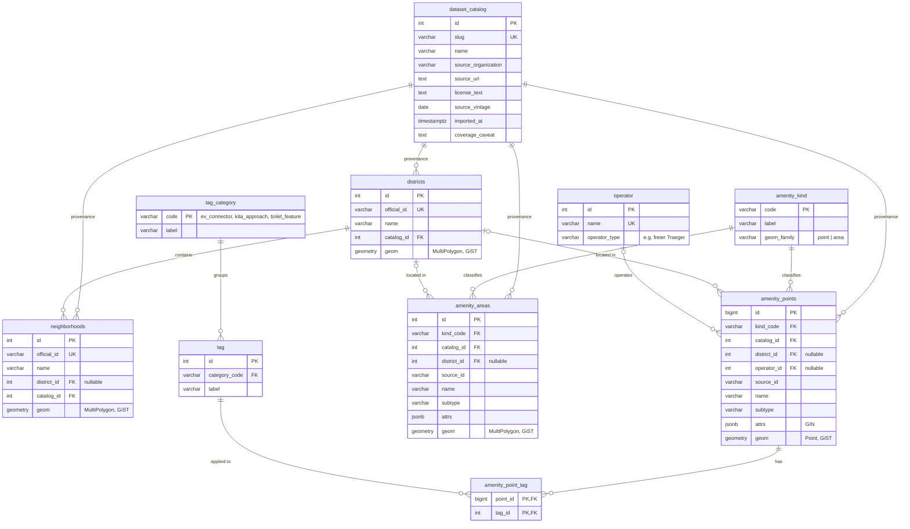

# ERD — schema v2

Geometry SRID: **EPSG:25833**. Renders on GitHub (Mermaid). Index details are in the table below the diagram, since Mermaid cannot draw them.

## Many-to-many: `amenity_points` ⟷ `tag`

Resolved by `amenity_point_tag` (composite PK `(point_id, tag_id)`). Real examples from the cached WFS data:

| Category | Example tags | Why it is M:N |
| --- | --- | --- |
| `ev_connector` | AC Typ 2 Steckdose, DC CHAdeMO, DC CCS … (7 distinct) | A charger has up to 4 connectors (`anschluss_1..4`); a connector type is used by thousands of chargers |
| `kita_approach` | Situationsansatz, Montessori, Reggio … (9 distinct) | 950 of 2,905 kitas list several approaches (`Offene-Arbeit/Situationsansatz`) |
| `toilet_feature` | barrierefrei, wickeltisch, fee-free … | A toilet has several features; each feature applies to many toilets |

This replaces `ang_1 = 'A/B'` and `anschluss_1 = 'X; Y'` style values, which violate 1NF, with real rows.

## Cardinalities

| Relationship | Cardinality | Key |
| --- | --- | --- |
| dataset_catalog → districts / neighborhoods / amenity_points / amenity_areas | 1:N | `catalog_id` |
| amenity_kind → amenity_points / amenity_areas | 1:N | `kind_code` |
| districts → neighborhoods | 1:N | `district_id` |
| districts → amenity_points / amenity_areas | 1:N, optional | `district_id` (assigned at import by spatial join) |
| operator → amenity_points | 1:N, optional | `operator_id` |
| tag_category → tag | 1:N | `category_code` |
| **amenity_points ⟷ tag** | **M:N** via `amenity_point_tag` | `(point_id, tag_id)` |

## Indexes

| Index | Type | Serves |
| --- | --- | --- |
| `ix_*_geom` (districts, neighborhoods, amenity_points, amenity_areas) | GiST | bbox, KNN `<->`, `ST_DWithin`, point-in-polygon |
| `ix_amenity_points_kind_geom` | GiST (btree_gist, `kind_code, geom`) | kind + bbox in one index scan (trees) |
| `ix_amenity_points_district`, `ix_amenity_areas_district` | btree | borough filters and density joins |
| `ix_amenity_points_operator` | btree | operator lookups |
| `ix_amenity_*_catalog` | btree | provenance joins |
| `ix_neighborhoods_district` | btree | district → neighborhoods |
| `amenity_point_tag_pkey` | btree `(point_id, tag_id)` | tags of a point |
| `ix_amenity_point_tag_tag` | btree `(tag_id, point_id)` | points with a tag (reverse direction) |
| `ix_amenity_points_attrs` | GIN (jsonb_path_ops) | `attrs @> '{…}'` lookups (Level 2) |
| `tag (category_code, label)` | UNIQUE | no duplicate tags |

## Why points and areas are separate

Same amenity role, different geometry type. Two tables keep PostGIS column typing honest (`Point` vs `MultiPolygon`), allow separate GiST indexes, and still remove ~15 look-alike layer tables.

## Kind codes

**Points:** `school`, `kita`, `hospital`, `street_tree`, `park_tree`, `bike_parking`, `ev_charger`, `drinking_fountain`, `bathing_water`, `toilet`, `sports_facility`, `park_and_ride`
**Areas:** `green_space`, `playground`, `cemetery`
