# ERD — schema v2

16 tables (+ 3 partitions of `amenity_points`). Geometry SRID: **EPSG:25833**. DDL: [schema.sql](schema.sql), verified on PostGIS 16. Mermaid renders on GitHub; indexes and constraints Mermaid cannot draw are listed below the diagram.

```mermaid
erDiagram
    dataset_catalog ||--o{ districts : "provenance"
    dataset_catalog ||--o{ neighborhoods : "provenance"
    dataset_catalog ||--o{ amenity_points : "provenance"
    dataset_catalog ||--o{ amenity_areas : "provenance"
    dataset_catalog ||--o{ import_run : "audited by"
    amenity_kind ||--o{ amenity_points : "classifies"
    amenity_kind ||--o{ amenity_areas : "classifies"
    districts ||--o{ neighborhoods : "contains"
    districts |o--o{ amenity_points : "located in"
    districts |o--o{ amenity_areas : "located in"
    operator |o--o{ amenity_points : "operates"
    amenity_kind ||--o{ kind_tag_category : "allows"
    tag_category ||--o{ kind_tag_category : "allowed on"
    tag_category ||--o{ tag : "groups"
    amenity_points ||--o{ amenity_point_tag : "has"
    tag ||--o{ amenity_point_tag : "applied to"
    kind_tag_category ||--o{ amenity_point_tag : "validates"
    amenity_points ||--o| tree_detail : "details"
    amenity_points ||--o| kita_detail : "details"
    amenity_points ||--o| ev_charger_detail : "details"
    tree_species |o--o{ tree_detail : "species of"

    dataset_catalog {
        int id PK
        varchar slug UK
        varchar name
        varchar source_organization
        text source_url
        text license_text
        date source_vintage
        text coverage_caveat
    }
    amenity_kind {
        varchar code PK
        varchar geom_family "point | area; UK(code, geom_family)"
        varchar label
    }
    districts {
        int id PK
        varchar official_id UK
        varchar name
        int catalog_id FK
        geometry geom "MultiPolygon, GiST"
    }
    neighborhoods {
        int id PK
        varchar official_id UK
        int district_id FK "nullable"
        int catalog_id FK
        geometry geom "MultiPolygon, GiST"
    }
    operator {
        int id PK
        varchar official_ref UK "nullable (Kita t_nr)"
        varchar name "UK where official_ref is null"
        varchar operator_type
    }
    amenity_points {
        bigint id PK "PK(id, kind_code)"
        varchar kind_code PK "partition key; FK(kind_code, geom_family)"
        varchar geom_family "CHECK = point"
        varchar source_id "UK(kind_code, source_id)"
        varchar name
        varchar subtype
        int catalog_id FK
        int district_id FK "nullable, derived"
        int operator_id FK "nullable"
        jsonb attrs "GIN"
        geometry geom "Point, GiST"
        timestamptz updated_at "trigger"
    }
    amenity_areas {
        int id PK
        varchar kind_code FK "FK(kind_code, geom_family)"
        varchar geom_family "CHECK = area"
        varchar source_id "UK(kind_code, source_id)"
        varchar name
        varchar subtype
        int catalog_id FK
        int district_id FK "nullable, derived"
        jsonb attrs "GIN"
        geometry geom "MultiPolygon, GiST, CHECK valid"
        timestamptz updated_at "trigger"
    }
    tag_category {
        varchar code PK
        varchar label
    }
    tag {
        int id PK "UK(id, category_code)"
        varchar category_code FK "UK(category_code, label)"
        varchar label
    }
    kind_tag_category {
        varchar kind_code PK, FK
        varchar category_code PK, FK
    }
    amenity_point_tag {
        bigint point_id PK, FK
        int tag_id PK, FK
        varchar kind_code FK "checked against point and category"
        varchar category_code FK "checked against tag"
    }
    tree_species {
        int id PK
        varchar botanical_name UK
        varchar german_name
        varchar genus
    }
    tree_detail {
        bigint point_id PK, FK
        varchar kind_code PK, FK "CHECK street_tree | park_tree"
        int species_id FK "nullable"
        smallint planting_year
        int trunk_circumference_cm
        numeric height_m "CHECK > 0"
        numeric crown_diameter_m "CHECK > 0"
    }
    kita_detail {
        bigint point_id PK, FK
        varchar kind_code PK, FK "CHECK kita"
        int capacity
    }
    ev_charger_detail {
        bigint point_id PK, FK
        varchar kind_code PK, FK "CHECK ev_charger"
        smallint charge_points
        numeric max_power_kw
        date commissioned_on
        boolean public_space
    }
    import_run {
        int id PK
        int catalog_id FK
        timestamptz started_at
        timestamptz finished_at
        varchar status "running | committed | failed"
        int rows_inserted
        int rows_updated
        int rows_deleted
        text error
    }
```

## Two many-to-many relationships

| M:N | Junction | Purpose |
| --- | --- | --- |
| `amenity_points` ⟷ `tag` | `amenity_point_tag (point_id, tag_id)` | EV connectors, Kita approaches, toilet features. Replaces source values like `Offene-Arbeit/Situationsansatz` (1NF). |
| `amenity_kind` ⟷ `tag_category` | `kind_tag_category (kind_code, category_code)` | Which tag categories may be used on which kinds. |

The junction repeats `kind_code` and `category_code` so three composite foreign keys can check every row:

| Composite FK | Rejects |
| --- | --- |
| `(point_id, kind_code)` → `amenity_points (id, kind_code)` | a kind that does not match the point |
| `(tag_id, category_code)` → `tag (id, category_code)` | a category that does not match the tag |
| `(kind_code, category_code)` → `kind_tag_category` | a category not allowed for that kind (a Kita approach on a toilet) |

## Cardinalities

| Relationship | Cardinality | Key |
| --- | --- | --- |
| dataset_catalog → districts / neighborhoods / amenity_points / amenity_areas / import_run | 1:N | `catalog_id` |
| amenity_kind → amenity_points / amenity_areas | 1:N | `(kind_code, geom_family)` |
| districts → neighborhoods | 1:N | `district_id` |
| districts → amenity_points / amenity_areas | 1:N, optional | `district_id` (derived by spatial join at import) |
| operator → amenity_points | 1:N, optional | `operator_id` |
| tag_category → tag | 1:N | `category_code` |
| amenity_points ⟷ tag | M:N | `amenity_point_tag` |
| amenity_kind ⟷ tag_category | M:N | `kind_tag_category` |
| amenity_points → tree_detail / kita_detail / ev_charger_detail | 1:0..1 | `(point_id, kind_code)` |
| tree_species → tree_detail | 1:N, optional | `species_id` |

## Partitioning

`amenity_points` is `PARTITION BY LIST (kind_code)`: `amenity_points_street_tree`, `amenity_points_park_tree`, and `amenity_points_other` (DEFAULT). The primary key must contain the partition key, so it is `(id, kind_code)`. This matches the composite foreign keys above.

## Indexes

| Index | Type | Serves |
| --- | --- | --- |
| `ix_*_geom` (districts, neighborhoods, amenity_points, amenity_areas) | GiST | bbox, KNN `<->`, `ST_DWithin`, point-in-polygon |
| `(kind_code, source_id)` unique | btree | import upsert key; kind lookups |
| `ix_amenity_points_district`, `ix_amenity_areas_district`, `ix_neighborhoods_district` | btree | borough filters and density joins |
| `ix_amenity_points_operator`, `ix_*_catalog`, `ix_tree_detail_species` | btree | FK joins |
| `amenity_point_tag` PK `(point_id, tag_id)` | btree | tags of a point |
| `ix_amenity_point_tag_tag (tag_id, point_id)` | btree | points with a tag |
| `ix_amenity_points_attrs`, `ix_amenity_areas_attrs` | GIN `jsonb_path_ops` | `attrs @> '{…}'` (Level 2) |
| `ux_operator_name_no_ref` | partial unique | operators without an official number |

Phase 7 compares a composite GiST `(kind_code, geom)` against partition pruning + plain GiST.

## Why points and areas are separate

Same amenity role, different geometry type. Two tables keep PostGIS column typing honest (`Point` vs `MultiPolygon`), allow separate GiST indexes, and still remove ~15 look-alike layer tables.

## Kind codes

**Points:** `school`, `kita`, `hospital`, `street_tree`, `park_tree`, `bike_parking`, `ev_charger`, `drinking_fountain`, `bathing_water`, `toilet`, `sports_facility`, `park_and_ride`
**Areas:** `green_space`, `playground`, `cemetery`
